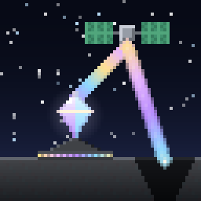

# Ender Laser Quarry



An [Ender IO](https://github.com/Team-EnderIO/EnderIO) addon for Minecraft 1.21.1 (NeoForge): a **satellite laser quarry**.

Satellite dishes charge a floating Laser Crystal, the crystal fires its beam up to a satellite in orbit, and the
satellite reflects it down onto the chunks you picked on a map. The satellite gets there on a reusable rocket from your
own launch pad, and maps the ground around it so you can see what you are about to mine. Late game, a Void Laser
Crystal turns the beam into space and mines asteroids instead.

> **Status: early development (0.6.3).** Expect changes, and back up your world before trying it.
## Requirements

| | Version |
|---|---|
| Minecraft | 1.21.1 |
| NeoForge | 21.1.200 or newer |
| Ender IO | 8.2.12-beta or newer (1.21.1 line) |

JEI is recommended for looking up the recipes.

## How it works

The setup has three parts: a **launch pad** that puts the satellite into orbit, the **laser quarry** (a 5x5 floor with
the Crystal Obelisk on top), and **satellite dishes** that power the crystal. A **Laser Linker** connects them.

### 1. Launch pad

- Build a **5x5 of Launch Pad Plating** on one layer with open sky above its middle.
- Put the **Launch Pad Controller** anywhere on the outer ring, in place of one plating. The middle plating turns into
  the orange pad once the 5x5 is complete.
- **Launch Pad I/O Ports** can replace plating on the outer ring to pipe in fuel, rockets and satellites.
- Give the controller a **Rocket**, a **Satellite** and **Rocket Fuel** (Ender IO's, 1,000 mB per flight), then press
  Launch. The rocket flies the satellite up, about 150 blocks, and lands again: the rocket is reusable.
- The same button brings the satellite back down later (with the rocket in its slot and an empty satellite slot).

### 2. Laser quarry

- Build a **5x5 floor of Laser Quarry Plating**. On its outer ring go exactly one **Quarry Controller** and one
  **Ground Radar**; **Laser Quarry I/O Ports** may replace any plating.
- Put the **Crystal Obelisk** on the middle block (open sky above it) and a **Laser Crystal** into it.
- Power goes into the quarry controller through a quarry I/O port. The controller needs a capacitor and feeds the radar.
- The laser needs **coolant**: water, through an I/O port, a bucket or the controller GUI.
- Mined items leave through the quarry I/O ports (set a side to push with the Yeta Wrench, or use the controller's IO
  config). A void filter slot can throw away what you don't want.

### 3. Satellite dishes

- A dish is a **3x3**: the **Satellite Dish** in the middle, **Satellite Dish Plating** around it (frame blocks of at
  least the dish's tier). One plating can be a **Satellite Dish I/O Port**: that is the only way to power a dish.
- Every dish needs an **Ender IO capacitor**. Better capacitors make it faster.
- Dishes must be within range of the obelisk; more dishes add up to more speed.

### 4. Link it up

With the **Laser Linker**: use it on a dish, then on the Crystal Obelisk. Use it on the Crystal Obelisk, then on the
Launch Pad Controller (within 128 blocks). The quarry controller and radar need no link: they belong to the floor they
sit on.

### 5. Mine

Once the satellite is in orbit and the radar has power, the satellite maps the chunks around the launch pad. Open the
**Quarry Controller**, pick chunks on the map (click or drag), and press Start. The quarry walls off liquids at the edge
of each chunk, then mines it down, chunk by chunk through the queue. While it runs it keeps its own base loaded.

## Tiers

The quarry controller, satellite, satellite dish and the platings come in **Basic**, **Enhanced** and **Ender** tiers
(crafting upgrades keep the item's contents). The controller decides how far the whole quarry can go:

| | Basic | Enhanced | Ender |
|---|---|---|---|
| Chunks in the queue | 9 | 27 | 81 |
| Dishes it combines | 2 | 4 | 8 |
| Max blocks per tick | 8 | 16 | 64 |
| Map radius (chunks) | 6 | 10 | 16 |
| Mining depth | to bedrock | to bedrock, to Y 0, or surface only | to bedrock, to any Y you pick, or surface only |
| Void Laser Crystal | | | asteroid mining |

The controller needs a satellite and a quarry floor of at least its own tier, and only uses dishes up to its tier.

### Enchanted crystals

A Laser Crystal can carry **Silk Touch** or **Fortune I-III** (enchanting table or anvil); the laser mines with them.

### Asteroid mining

With a **Void Laser Crystal** on an Ender quarry, the controller map turns into a space map. Run a space scan (it costs
radar power), pick asteroids, and the quarry mines them instead of the ground. Asteroids come from Overworld, Nether
and End biomes, with ores and rock in proportions measured from real world generation.

## Configuration

`config/ender_laser_quarry-common.toml`: energy costs, coolant, dish and controller power, rocket fuel per flight,
orbit altitude, link range, chunk loading, and every tier value above. Energy shows in Ender IO's unit (µI).

Changed defaults in a new version of the mod don't reach an existing config file; delete the file (or the entry) to
get the new default.

## Building from source

```
gradlew build
```

The jar ends up in `build/libs/`. `gradlew runClient` starts a development client with Ender IO and JEI.

## License

[CC0 1.0](LICENSE), public domain, like Ender IO.

## Credits

Built on Ender IO by Team Ender IO. Developed with the help of AI tools.
