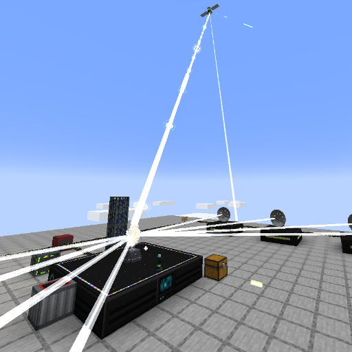
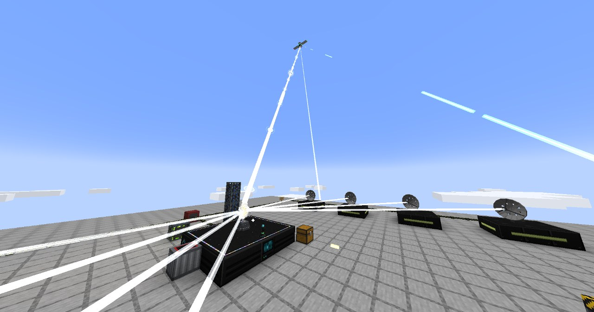
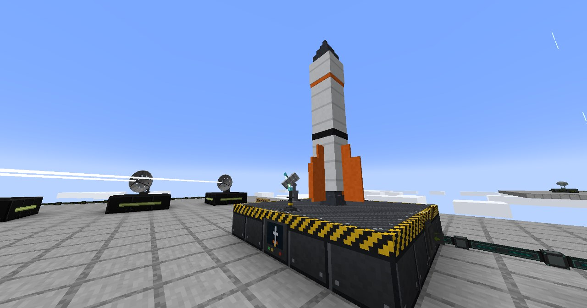
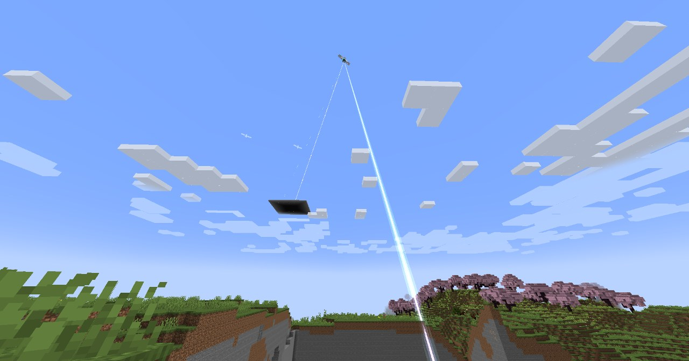
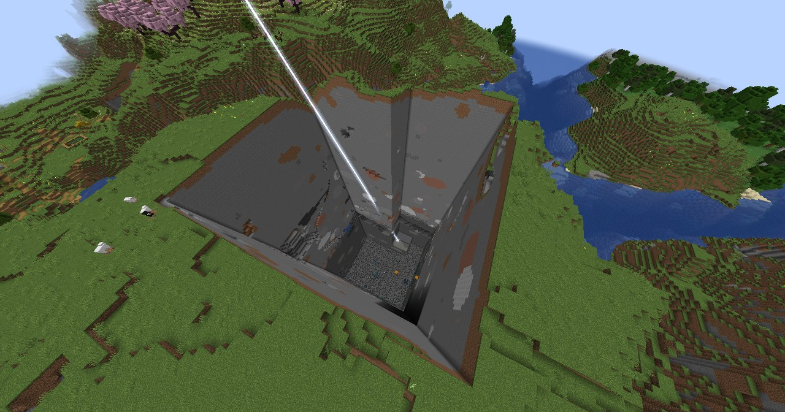
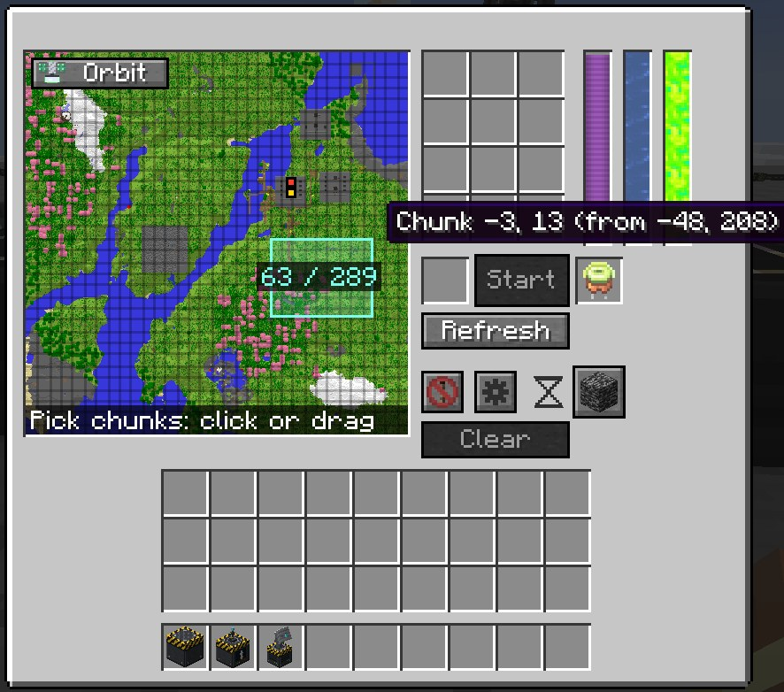
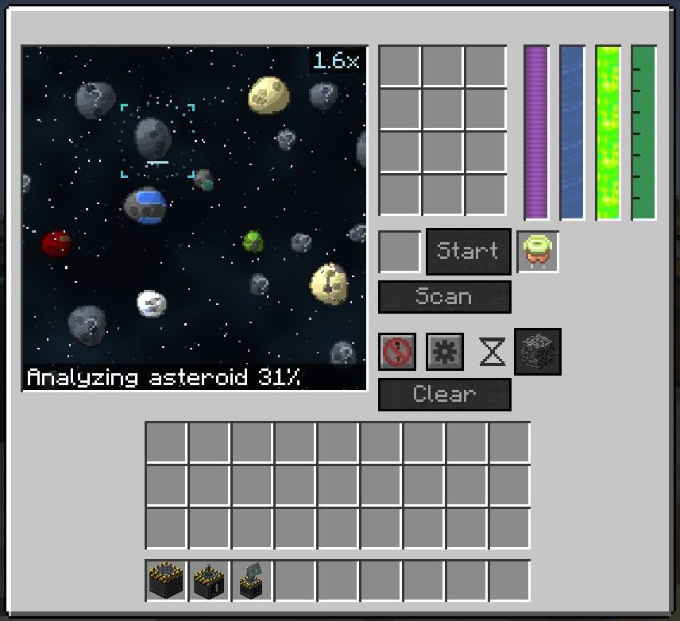

# Ender Laser Quarry



An [Ender IO](https://github.com/Team-EnderIO/EnderIO) addon for Minecraft 1.21.1 (NeoForge): a **satellite laser quarry**.

Satellite dishes charge a floating Laser Crystal, the crystal fires its beam up to your satellite in orbit, and the
satellite reflects it down onto the chunks you pick on its map. You fly the satellite up yourself, on a reusable rocket
from your own launch pad. Late game, the Void Satellite and a Void Laser Crystal turn the beam to space and mine
asteroids instead.



> **Beta (0.8.0).** This is the first public test version. Things may still change between versions, so back up your
> world before you try it. Feedback and bug reports are very welcome in the
> [issues](https://github.com/makla90/ender-laser-quarry/issues).

## Try it in one command

In a creative test world, run **`/elq demo`** (needs operator rights). It builds a complete, powered base at Y 200
around you, with a sign at every part explaining what it does. Variants: `/elq demo basic`, `/elq demo enhanced`,
`/elq demo ender` and `/elq demo asteroid` (asteroid mining with the Void Satellite already in orbit). The demo's power
source and the **Dev Trash Can** at its output are creative-only test blocks.

## Screenshots

| | |
|---|---|
|  |  |
| Your own launch pad and reusable rocket | The satellite reflects the beam down onto the chunks you picked |
|  |  |
| Chunk by chunk, down to bedrock | Pick chunks on the map the satellite scanned |
|  | |
| Late game: scan space, analyze asteroids and mine them | |

## Requirements

| | Version |
|---|---|
| Minecraft | 1.21.1 |
| NeoForge | 21.1.216 or newer |
| Ender IO | 8.2.13-beta or newer (1.21.1 line) |
| Ender IO - Endergy | optional: its capacitors make dishes faster |

JEI is recommended for looking up the recipes.

## How it works

The setup has three parts: a **launch pad** that puts the satellite into orbit, the **laser quarry** (a 5x5 floor with
the Crystal Obelisk on top) and **satellite dishes** that power the crystal. A **Laser Linker** connects them.

### 1. Launch pad

- Build a **5x5 of Launch Pad Plating** on one layer, with open sky above its middle.
- On the outer ring go the **Launch Pad Controller** and the **Ground Radar**, each in place of one plating.
  **Launch Pad I/O Ports** can replace plating on the ring to pipe in fuel, rockets and satellites.
- Give the controller a **Rocket**, a **Satellite** and Ender IO's **Rocket Fuel**, then press Launch. Heavier
  satellites need more fuel: 1,000 / 2,000 / 4,000 mB for Basic / Enhanced / Ender. The rocket flies the satellite up
  about 150 blocks and lands again: it is reusable.
- The same button brings the satellite back down later.
- Once in orbit, the satellite maps the chunks around the pad. The radar needs power, which the linked quarry controller
  sends over its antenna, so the pad needs no cable.

### 2. Laser quarry

- Build a **5x5 floor of Laser Quarry Plating**. On its outer ring goes the **Quarry Controller**; **Laser Quarry I/O
  Ports** may replace any plating.
- Put the **Crystal Obelisk** on the middle block (open sky above it) and a **Laser Crystal** into it.
- Everything goes through the I/O ports: power, **coolant** (water) for the laser, liquid XP for Mending, and the mined
  items out. The controller needs an Ender IO capacitor; a better one moves more items, fluid and energy per port.

### 3. Satellite dishes

- A dish is a **3x3**: the **Satellite Dish** in the middle, **Satellite Dish Plating** around it. One plating can be a
  **Satellite Dish I/O Port**: that is the only way to power a dish.
- Every dish needs an **Ender IO capacitor**. Better capacitors make it much faster (Basic, Double-Layer, Octadic; on
  Ender dishes also Endergy's).
- Dishes must be within range of the obelisk; more dishes add up to more speed.

### 4. Link it up

With the **Laser Linker**: use it on a dish, then on the Crystal Obelisk (once per dish). Use it on the Quarry
Controller, then on the Launch Pad Controller.

### 5. Mine

Open the **Quarry Controller**, pick chunks on the satellite's map (click or drag) and press Start. The quarry powers up
for a few seconds, walls off water and lava at the edge of the area, then mines chunk by chunk through the queue. When
it is done, it goes over the area once more and removes any water left behind. While it runs it keeps its own base
loaded.

## Tiers

The quarry controller, satellite, satellite dish and the platings come in **Basic**, **Enhanced** and **Ender** tiers
(crafting upgrades keep the item's contents). The controller decides how far the whole quarry can go:

| | Basic | Enhanced | Ender |
|---|---|---|---|
| Chunks in the queue | 9 | 49 | 289 |
| Dishes it combines | 2 | 4 | 8 |
| Max blocks per tick | 8 | 32 | 400 |
| Map radius (chunks) | 6 | 10 | 16 |
| Link range to the launch pad | 128 | 256 | 512 |
| Mining depth | to bedrock | to bedrock, to Y 0, or surface only | to bedrock, to any Y you pick, or surface only |
| Orbit transfer (move the satellite) | | up to 10 chunks | up to 24 chunks |
| Asteroid mining | | | with the Void Satellite |

The controller needs a satellite and a quarry floor of at least its own tier, and only uses dishes up to its tier.

### Laser crystals

The crystal wears down while it mines. It can carry **Silk Touch**, **Fortune I-III**, **Unbreaking** and **Mending**
(enchanting table or anvil). With Mending, it repairs itself from liquid XP piped into the quarry.

### Orbit transfer

Enhanced and Ender satellites can fly to a new spot without landing: pick it in the controller's orbit planner, and the
pad sends a rocket with the fuel. Then the satellite maps and mines that area instead.

### Asteroid mining

The **Void Satellite** (an upgraded Ender Satellite) and a **Void Laser Crystal** turn an Ender quarry to space. The
satellite carries **Dew of the Void** (Ender IO) for its space scans; the launch pad can send it more on a resupply
flight. A scan finds asteroids, the controller can analyze them, and then you queue them and mine them like chunks.
Asteroids come from Overworld, Nether and End biomes, with ores and rock in the proportions of real world generation.

## Claim and protection mods

The laser asks claim mods before it breaks a block, as if the quarry's owner did it by hand. Chunks you may not mine
are skipped. Tested with Open Parties and Claims and FTB Chunks.

## Configuration

`config/ender_laser_quarry-common.toml`: energy costs, coolant, crystal wear, dish and controller power, rocket fuel,
orbit altitude, link range, chunk loading, claim checks and every tier value above. Energy shows in Ender IO's unit
(µI).

Changed defaults in a new version of the mod don't reach an existing config file; delete the file (or the entry) to get
the new default.

## Building from source

```
gradlew build
```

The jar ends up in `build/libs/`. `gradlew runClient` starts a development client with Ender IO and JEI.

## License

[CC0 1.0](LICENSE), public domain.

## Credits

Built on Ender IO by Team Ender IO. Developed with the help of AI tools.

Unofficial addon, not made by or affiliated with Team Ender IO.

Not an official Minecraft product. Not approved by or associated with Mojang or Microsoft.
